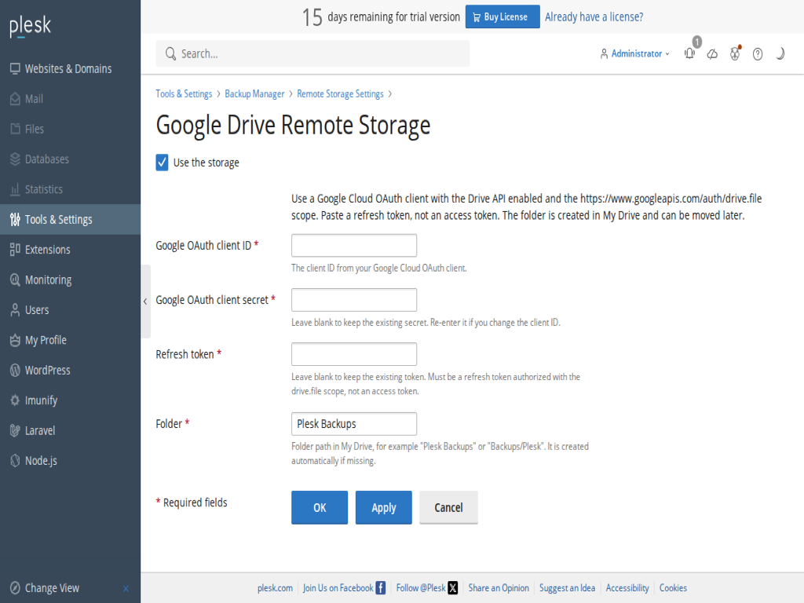

# Plesk Google Drive Backup

[](https://github.com/feruzabad/plesk-google-drive-backup/actions/workflows/ci.yml)
[](https://github.com/feruzabad/plesk-google-drive-backup/actions/workflows/release.yml)
[](LICENSE)


An open-source Plesk extension that adds **Google Drive** as a remote storage destination in **Backup Manager → Remote Storage Settings**, next to FTP(S).

It uses your own Google OAuth client and the non-sensitive `drive.file` scope. Backups are stored in an app-managed folder in Google Drive. There is no public OAuth callback, no Plesk-hosted OAuth relay, and no inbound port requirement.



## Features

- Server-wide Google Drive configuration managed by the Plesk administrator.
- Manual subscription backups can use the server-wide configuration after enabling **Use the storage** once per subscription.
- Server-wide scheduled backups to Google Drive.
- Streaming resumable uploads with bounded memory use; no whole-backup staging.
- Restore using HTTP range requests.
- MD5 verification through Google Drive's `md5Checksum`.
- Drive quota reporting.
- Credentials stored encrypted in Plesk's key-value storage.
- Hook-only extension: no separate UI page; settings appear inside Plesk Backup Manager.
- PHP 8.4 codebase, PHPStan level **max**, and automated CI/release workflows.

## Requirements

- Plesk Obsidian **18.0.50 or newer** (tested on 18.0.82).
- Panel PHP **8.4 or newer** (tested on 8.4.27).
- Outbound HTTPS to `oauth2.googleapis.com`, `www.googleapis.com`, and Plesk licensing/update servers.
- A Google Cloud OAuth client with:
  - the **Google Drive API** enabled;
  - the `https://www.googleapis.com/auth/drive.file` scope;
  - a refresh token issued for that client and scope.

No public inbound access or public hostname is required for the manual refresh-token flow.

## Installation

Download the latest ZIP from [GitHub Releases](https://github.com/feruzabad/plesk-google-drive-backup/releases), then install it in Plesk:

```bash
plesk bin extension -i gdrive-backup-<version>.zip
```

Or upload the ZIP from **Extensions → Upload Extension** in Plesk.

To build from source:

```bash
git clone https://github.com/feruzabad/plesk-google-drive-backup.git
cd plesk-google-drive-backup
composer install
composer test
composer phpstan
composer run build
```

The installable package is written to `dist/gdrive-backup-<version>.zip`.

## Google Cloud setup

1. Create or select a Google Cloud project.
2. Enable the **Google Drive API**.
3. Configure the OAuth consent screen:
   - **Internal** if the project belongs to a Google Workspace organization, or **External** for personal Gmail.
   - Add the scope `https://www.googleapis.com/auth/drive.file`.
   - If the app is External and remains in **Testing**, Google expires refresh tokens after 7 days. Publish it to Production for long-running backups.
4. Create an OAuth client ID of type **Web application**.
5. Add `https://developers.google.com/oauthplayground` as an authorized redirect URI.
6. Open the [OAuth 2.0 Playground](https://developers.google.com/oauthplayground/):
   - Open the settings gear and enable **Use your own OAuth credentials**.
   - Enter your client ID and client secret.
   - In Step 1, authorize `https://www.googleapis.com/auth/drive.file`.
   - Exchange the authorization code in Step 2 and copy the **refresh token**.
7. Keep the client ID, client secret, and refresh token ready for Plesk.

The refresh token is a long-lived credential. Treat it like a password.

## Plesk configuration

1. Go to **Tools & Settings → Backup Manager → Remote Storage Settings**.
2. Open **Google Drive Remote Storage**.
3. Check **Use the storage**.
4. Enter the OAuth client ID, client secret, refresh token, and folder.
5. Click **Apply**.

The extension validates the token, checks the `drive.file` scope, creates the folder if needed, and stores the credentials encrypted. The folder name defaults to `Plesk Backups`; nested paths such as `Backups/Plesk` are supported.

The Google account email is not displayed in the Plesk UI.

### Enabling the inherited storage for a subscription

Google Drive credentials are configured once at the server level. For each subscription that should use them for manual backups:

1. Open that subscription's **Backup Manager → Remote Storage Settings**.
2. Open **Google Drive Remote Storage**.
3. Check **Use the storage** and click **Apply**.

The subscription form is read-only: it shows the inherited server configuration and cannot change credentials. This is Plesk's per-object activation flag.

## How it works

Plesk calls a transport hook with a POSIX-like file API:

- `stat`, `listDir`, `createDir`, `deleteFile`, `deleteDir`
- `openFileWrite` → repeated `appendFile` chunks → `closeFile`
- `openFileRead` with an offset → repeated `readFile` calls
- `check` before backups, plus optional quota and MD5 hash reporting

The extension:

- streams uploads through Google's resumable upload protocol in 16 MiB chunks;
- holds back one chunk until `closeFile`, because Plesk does not provide the total backup size up front;
- uses HTTP `Range` requests for restore;
- reports MD5 from Drive's `md5Checksum` so Plesk can verify files;
- stores secrets with `pm_Settings::setEncrypted()`.

The PHP runtime is the **Plesk panel PHP**, not a website PHP handler. This matters when choosing PHP versions.

## Folder layout

```text
<configured folder>/
  <plesk-hostname>/
    server/
    subscription-<id>/
    customer-<id>/
    reseller-<id>/
      <Plesk backup paths>
```

The hostname level prevents collisions when the same Google Drive account or folder is reused by more than one Plesk server.

`drive.file` means the extension can only see and manage files it created itself. It cannot select an existing folder that you created manually in Drive. The extension creates its own folder; you can move it afterward. Workspace Shared Drives are not supported yet.

## Scheduling and Plesk licensing

- **Server-wide scheduled backups to Google Drive** are supported and tested.
- **Manual subscription backups** are supported.
- **Scheduled subscription/customer/reseller backups to remote cloud storage** are gated by Plesk behind **Backup to Cloud Pro**. Plesk shows a purchase dialog when you try to save such a schedule. FTP/SFTP are exempt from that gate.
- The extension itself does not require a Plesk paid feature; the limitation comes from Plesk's licensing/UI.

## Security

- Client secret, refresh token, and cached access token are stored with `pm_Settings::setEncrypted()`.
- Secrets are never rendered back into the form and are not written to logs.
- The extension uses the non-sensitive `drive.file` scope.
- The refresh token is not displayed in Plesk.
- Revoke access at <https://myaccount.google.com/permissions> if the extension is retired or the token is compromised.
- Never commit client secrets, refresh tokens, or access tokens to this repository.

Please report security issues privately; see [SECURITY.md](SECURITY.md).

## Troubleshooting

| Symptom | Action |
| --- | --- |
| `invalid_grant` | Refresh token expired, was revoked, or belongs to a different OAuth client. Generate a new token. If the OAuth app is External + Testing, publish it to Production. |
| `invalid_client` | Client ID/secret mismatch or the OAuth client was deleted. |
| `accessNotConfigured` | Enable the Google Drive API in the Google Cloud project. |
| `insufficientPermissions` / 403 | The token lacks `drive.file`, or Workspace restrictions block the app. |
| `storageQuotaExceeded` | The Google account is out of storage. |
| Subscription shows **Not configured** | Open the subscription's Remote Storage Settings → Google Drive Remote Storage → check **Use the storage** → Apply. |
| Network errors | Verify outbound HTTPS from the Plesk server to `www.googleapis.com`. |
| `pmm-ras` check fails | Run `pmm-ras --check-repository --dump-storage=ext://gdrive-backup/server/` and inspect `/var/log/plesk/panel.log`. |

## Development

Requirements: PHP 8.4, Composer, and optionally Docker.

```bash
composer install
composer phpstan   # PHPStan level max, phpVersion 8.4
composer test      # PHPUnit
composer run build # production vendor + pruned Drive service + ZIP
```

The build script:

1. Installs production dependencies in a staging Composer project.
2. Prunes `google/apiclient-services` from about 150 MB to the Drive service only.
3. Copies the vendor tree into `plib/vendor`.
4. Regenerates the optimized autoloader and creates the installable ZIP.

To update the Google client:

```bash
composer update google/apiclient --with-dependencies
composer audit
composer phpstan
composer test
composer run build
```

The extension code must remain compatible with the Plesk panel PHP version. The panel PHP is not selectable per extension.

## Releases

GitHub Actions builds and tests every push to `main` and every pull request via [CI](.github/workflows/ci.yml).

To publish a release:

1. Update `src/meta.xml` `<version>` (for example `1.2.0`).
2. Update `CHANGES.md`.
3. Commit and push to `main`.
4. Create and push a matching tag:

```bash
git tag v1.2.0
git push origin v1.2.0
```

The [release workflow](.github/workflows/release.yml) verifies that the tag matches `src/meta.xml`, runs PHPStan and PHPUnit, builds `dist/gdrive-backup-<version>.zip`, generates `SHA256SUMS`, and publishes a GitHub Release with both files.

## Contributing

Issues and pull requests are welcome. See [CONTRIBUTING.md](CONTRIBUTING.md). Please do not open public issues for security vulnerabilities.

## License

MIT License. See [LICENSE](LICENSE).

This project is not affiliated with Google LLC or WebPros International GmbH. Google Drive and Plesk are trademarks of their respective owners.
